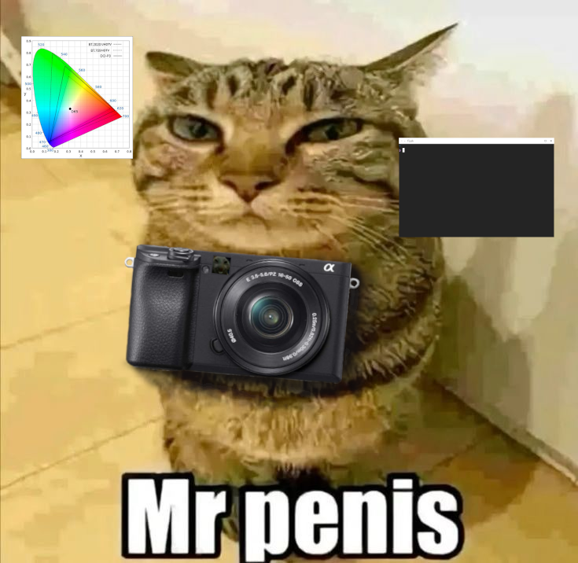

# mrpenishot

_Wayland screenshot application written in the V programming language_



### Dependencies
- [V compiler](https://vlang.io/)
- [dy-tea.wayland](https://github.com/dy-tea/wayland)
- [pixman-1](https://gitlab.freedesktop.org/pixman/pixman)
- [libjxl](https://github.com/libjxl/libjxl)
- [libpng16](https://github.com/pnggroup/libpng)
- pkg-config

### Building
```sh
v install # if dependencies are not installed
v .  # build
```

### Features
- Screenshot all outputs
- Screenshot specific output
- Screenshot specific region
- Screenshot specific toplevel
- Include or exclude cursor
- PNG, JXL, QOI and PPM support
- HDR support
- Screen freezing support

### Usage
```sh
mrpenishot                                                 # all outputs
mrpenishot -c                                              # including cursor
mrpenishot out.png                                         # output to file
mrpenishot -o "DP-1"                                       # geometry of output
mrpenishot -f jxl                                          # output to jxl
mrpenishot -g "100,200 300x400"                            # geometry
mrpenishot -g "$(slurp)"                                   # geometry from slurp
mrpenishot -t "$(doorsctl query -f | jq -r '.identifier')" # capture toplevel in doors
mrpenishot - | wl-copy                                     # copy image to clipboard
mrpenishot -F 'sleep 2'                                    # freeze for 2 seconds and screenshot
mrpenishot -F '' -g '$(slurp)'                             # screenshot and freeze until slurp exits, geometry from slurp
```

### References
- [grim](https://gitlab.freedesktop.org/emersion/grim)
